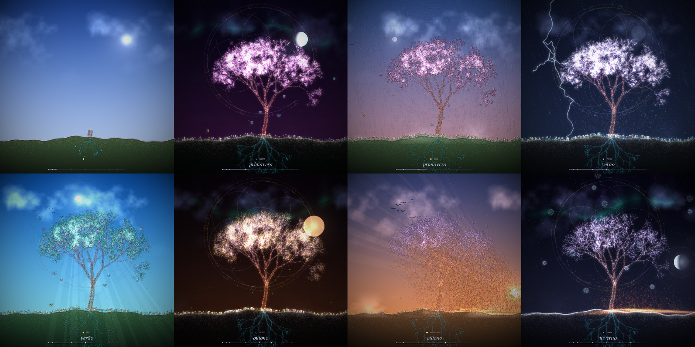

# Árvore da Vida

Animação de partículas em Python: uma semente de luz cai do céu, cria raízes,
cresce como árvore e atravessa as quatro estações até se dissolver em luz e
renascer. Cada ciclo (~1 min) gera uma árvore diferente.



## Como rodar

```
pip install -r requirements.txt
python arvore_da_vida.py
```

No Windows, se `python`/`pip` não forem encontrados, use
`py -m pip install -r requirements.txt` e `py arvore_da_vida.py`.

Opcional: `python arvore_da_vida.py --seed 21` sempre gera a mesma árvore.

## Dia e noite

Um dia completo passa a cada ~10 segundos, então cada estação mostra
amanhecer, dia, entardecer e noite.

- Sol e lua cruzam o céu; a lua tem fases diferentes a cada noite
- Céu com cor própria de cada estação, crepúsculo alaranjado e rosado
- Nuvens, estrelas (somem de dia), aurora, estrela cadente, raios de sol e brilho de lente
- A legenda mostra a parte do dia com um pequeno ícone de sol ou lua

## O que acontece em cada estação

| Estação | Detalhes |
|---|---|
| Primavera | borboletas, chuva fina, arco-íris, flores no chão, pétalas ao vento |
| Verão | raios de sol, pássaros, frutos, tempestade com relâmpagos, vaga-lumes |
| Outono | ventania, redemoinho de folhas, cogumelos brilhantes, névoa, gansos, lua da colheita |
| Inverno | neve acumulada, pingentes de gelo, flocos de cristal, nevasca, halo da lua |

## Controles

| Tecla    | Ação                                                        |
|----------|-------------------------------------------------------------|
| Espaço   | pausar / continuar                                          |
| ← / →    | voltar / avançar 4 segundos                                 |
| D        | próxima parte do dia (amanhecer, dia, entardecer, noite)    |
| 1 … 8    | pular para uma fase                                         |
| R        | nova árvore                                                 |
| S        | salvar imagem (png)                                         |
| ESC      | sair                                                        |

## Ajustes rápidos (topo do arquivo)

- `W, H`: tamanho da janela (diminua, por exemplo para 700×700, se ficar lento)
- `DAY_LEN`: duração de um dia (padrão `CYCLE / 6`; use `CYCLE / 3` para dias mais lentos)
- `TRAIL`: rastro das partículas (0 desliga)
- `EXPOSURE`: brilho geral
- Paletas: `SKY_KEYS` (noite), `SKY_DAY_KEYS` (dia), `GROUND_DAY`, `SPRING_P`, `SUMMER_P`, `AUTUMN_P`
- `FLOCKS`, `GUSTS` e `BOLTS`: quando passam os bandos de pássaros, as ventanias e os relâmpagos
